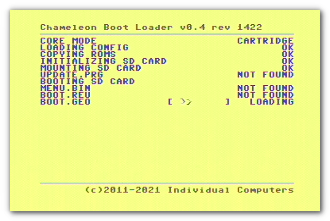
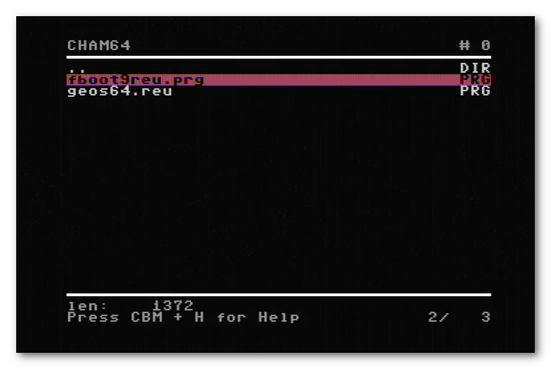
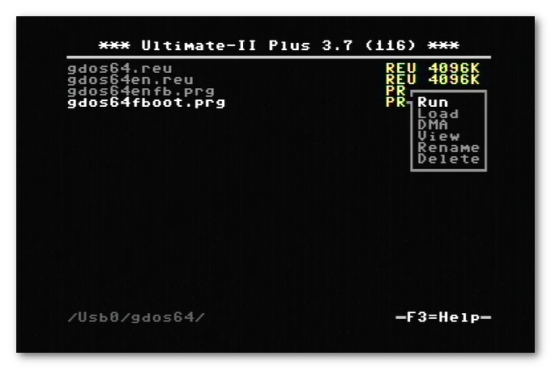

# Area6510

## GDOS64-FASTBOOT HOWTO
Step-by-Step installation HowTo for GDOS64 fastboot with TurboChamelon64 (and Ultimate).

## DEMO VIDEOS
PowerOn autoboot with TurboChameleon64: [Click!](https://bitbucket.org/mkgit64/myarea6510/raw/master/doc/gdos64-fastboot/video/TC64-AutoBoot-GDOS64.mp4)

Manually starting GEOS64 using TurboChameleon64: [Click!](https://bitbucket.org/mkgit64/area6510/raw/master/doc/gdos64-fastboot/video/TC64-ManuellerStart-GEOS64.mp4)

Manually starting GDOS64 using Ultimate2+ (with 1MHz!): [Click!](https://bitbucket.org/mkgit64/area6510/raw/master/doc/gdos64-fastboot/video/Ultimate-ManuellerStart-GDOS64.mp4)

