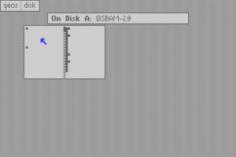
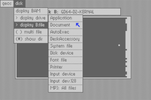

# Area6510

### DisplayBAM2

##### DisplayBAM by Nathan Fiedler
Displays the Block Availability Map (BAM) for any disk of type 1541, 1571, or 1581.

##### DisplayBAM2 updated by Markus Kanet
Display Block Availability Map of any disk incl. CMD native mode and file type support.

#### Screenshots

