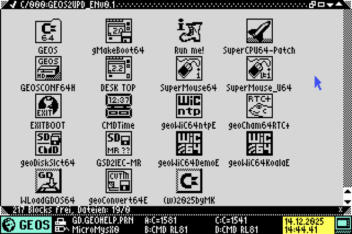
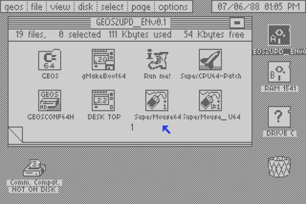
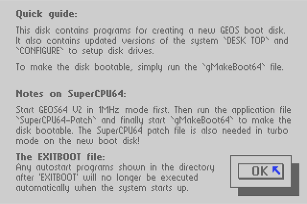
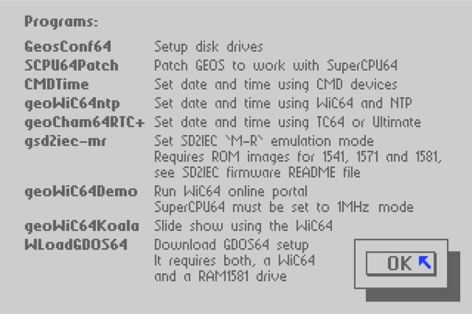
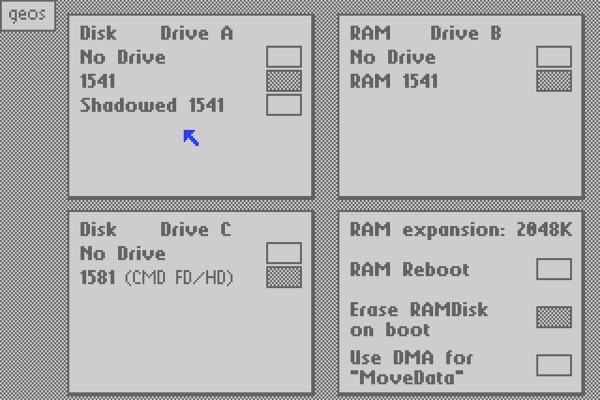
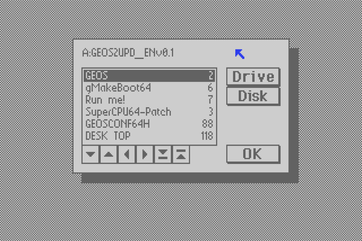
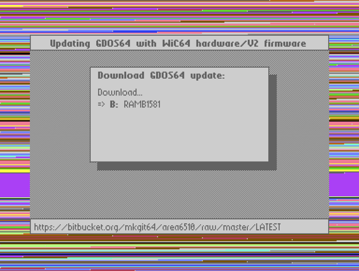

# Area6510

### gMakeBoot64
gMakeBoot64 is a fork of CMD's geoMakeBoot. The original tool has been disassembled and slightly improved.

#### GEOS-Update
This is a collection of utilities to create a new boot disk from a stock GEOS64 V2 system disk and is based on gMakeBoot64.

Included programs:

* gMakeBoot64, make a disk a "GEOS boot disk".
* DESK TOP, updated GEOS64 deskTop.
* GeosConf64, updated 'CONFIGURE' to set up disk drives.
* SCPU64Patch, patch GEOS to work with SuperCPU64.
* CMDTime, set date and time using CMD devices.
* geoWiC64ntp, set date and time using WiC64 and NTP.
* geoCham64RTC+, set date and time using TC64 or Ultimate.
* geoDiskSlct64, switch between disk images on SD2IEC or partitions on CMD drives.
* gsd2iec-mr, set SD2IEC 'M-R' emulation mode. Requires ROM images for 1541, 1571 and 1581, see SD2IEC firmware README file.
* geoWiC64Demo, run WiC64 online portal. SuperCPU64 must be set to 1MHz mode!
* geoWiC64Koala, Slide show using the WiC64.
* WLoadGDOS64, Download GDOS64 setup. It requires both, a WiC64 and a RAM1581 drive.
* geoConvert64, convert GEOS/CVT files and create/write D64/D71/D81 disks.

